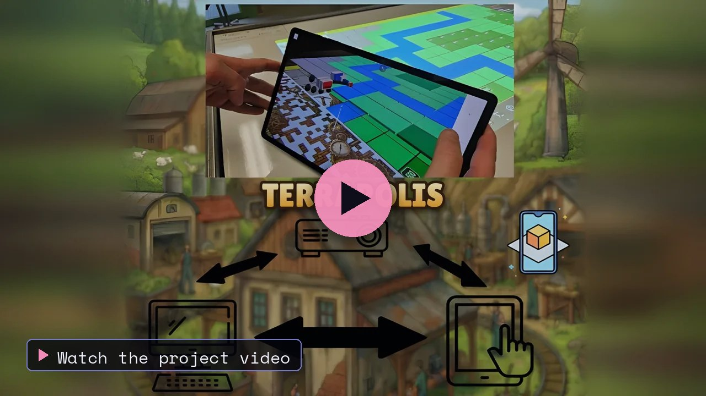
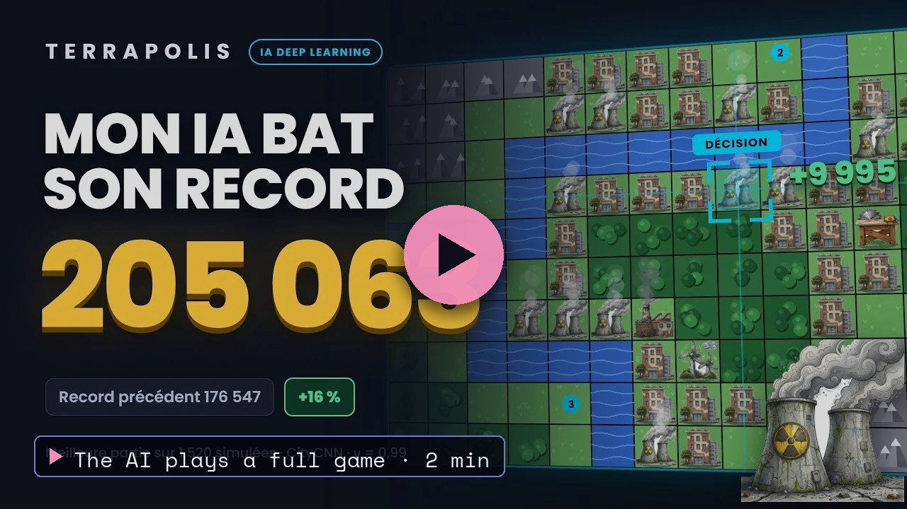
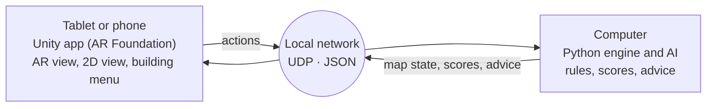
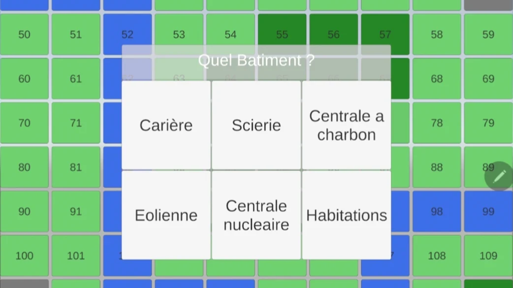
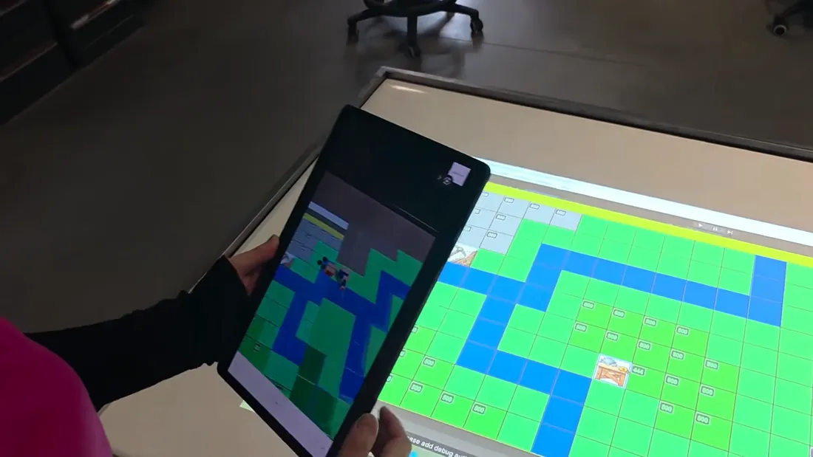
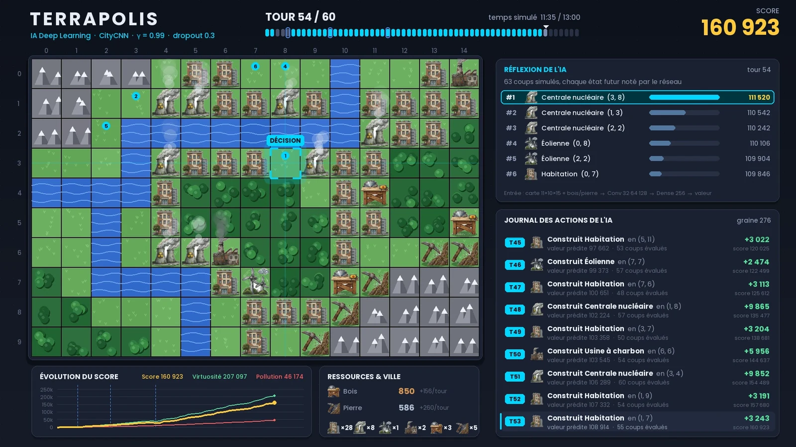
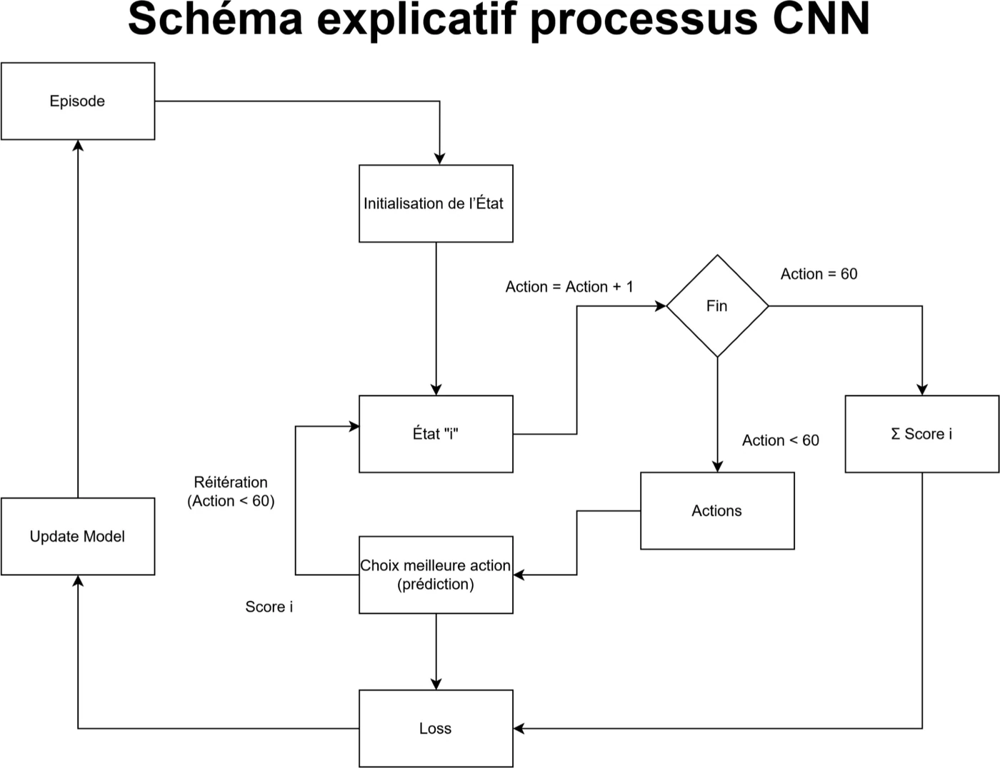
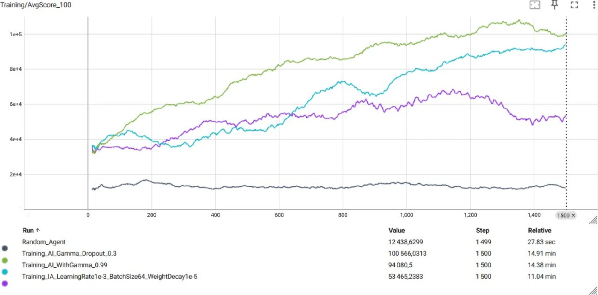

<a href="https://thibautplatet.com/en/projects/terrapolis.html"><picture><source media="(prefers-color-scheme: dark)" srcset="https://raw.githubusercontent.com/ThibPltt/ThibPltt/main/assets/repos/Terrapolis-dark.svg"><source media="(prefers-color-scheme: light)" srcset="https://raw.githubusercontent.com/ThibPltt/ThibPltt/main/assets/repos/Terrapolis-light.svg"></picture></a>

# TerraPolis

Environmental and anthropological simulation in AR, driven by Deep Reinforcement Learning (CNN).

<table>
  <tr>
    <td width="50%"></td>
    <td width="50%"></td>
  </tr>
  <tr>
    <td>The project in video.</td>
    <td>The AI plays its best game out of 1,520 simulated: 205,063 points.</td>
  </tr>
</table>

| At a glance | |
|---|---|
| **Dates** | 2025 – 2026 |
| **Context** | augmented reality · project lead, team of 3 · ENSIM |
| **Technologies** | AR · Deep Reinforcement Learning · Unity · Python |
| **Code** | [Terrapolis_Python](https://github.com/Lecureur-Arthur/Terrapolis_Python) (engine and AI) · [Terrapolis_Unity](https://github.com/Lecureur-Arthur/Terrapolis_Unity) (AR client) |
| **Case study** | [thibautplatet.com/en/projects/terrapolis.html](https://thibautplatet.com/en/projects/terrapolis.html) |

## Problem

Show the consequences of a planning choice (pollution, floods) before anything is built: a sustainable city simulation designed for urban planning studies.

## Role

Project lead, team of 3.

## Decisions

An AI trained with Deep Reinforcement Learning (CNN), learning in stages; a Python simulation engine linked over UDP to a Unity app in augmented reality.

## Result

Working prototype, tried by visitors at the ENSIM open day. Over 1,000 games, the AI scores on average 4.75 times higher than a random strategy.

## My contribution

- Most of the artificial intelligence: problem modelling, neural network, training strategy, tuning and evaluation.
- The larger share of the state of the art: mixed reality and AI for disaster prevention.
- A part in designing the rules, in the Python simulation engine and in project management.

## Specification

| Requirement | Answer |
|---|---|
| A city to build | A fixed map of 15 × 10 tiles (mountain, forest, plain, river), two resources (wood, stone) and six buildings: sawmill, quarry, housing, coal power plant, wind turbine, nuclear power plant. |
| A score, with no win or loss | Final score = virtue of what is built − pollution (at construction, then over time) − flood damage. A game lasts 15 minutes. |
| Two hazards | Random floods (up to two per game) destroy the buildings next to rivers; industrial pollution contaminates the tiles next to sawmills, quarries and coal plants. |
| Advice on demand | An "AI advice" button suggests the best action given the resources and the free tiles: build, demolish or wait. |
| Augmented reality | The map appears on a table after scanning a QR code; buildings are placed on it in 3D, with a preview before confirming. |
| Two devices in sync | The computer computes (rules and AI in Python), the tablet displays (Unity app); they talk over UDP on the local network, in JSON. |

## How it works

<table>
  <tr>
    <td width="33%"></td>
    <td width="33%"></td>
    <td width="33%"></td>
  </tr>
  <tr>
    <td>On the tablet: the 2D view and the menu of the six buildings to place (interface in French).</td>
    <td>The tablet and the projected map show the same state, kept in sync over the network.</td>
    <td>On the computer: the map, the moves the AI evaluates at each turn and the log of its actions (interface in French).</td>
  </tr>
</table>

## The artificial intelligence

The game grid is handled like an image: a convolutional neural network (CNN) learns, through reinforcement, which action pays off most over a whole game.

- **Inputs:** the state of the land (one matrix per type of tile and building) and the available resources. **Output:** the estimated value of each action.
- Three convolution layers (32, 64 then 128 filters, 3 × 3) that learn neighbourhoods: riverside, nearby forest, map corner…
- One game = 60 decisions, one every 15 seconds. Exploration, high at first, decreases with every episode in favour of the best moves.

**The turning point: learning in stages.** Given all the rules at once, the AI mostly learned to build nothing so as not to lose points. Training was therefore split into three phases (curriculum learning):

1. Unlimited resources, pollution ignored, a reward for building: learning the mechanics.
2. Pollution back, resources still unlimited: learning that a bad location is costly in the long run.
3. Resources reset to zero and decreasing exploration: exploiting the best behaviours.

One episode: state, choice of the best action, score, then model update (diagram in French).

## Results

| Scores | Random strategy | Trained AI |
|---|---:|---:|
| Worst score | −20,174 | −3,639 |
| Average score | 12,940 | **61,428** |
| Best score | 54,685 | **205,063** |

Worst and average scores: 1,000 test games. Best score of the AI: its best game out of 1,520 simulated. An average game by the AI (61,428) beats the best game obtained at random (54,685).

Average score (over 100 episodes) during the final training run of 1,500 episodes, tracked with TensorBoard. In green, the configuration that was kept (with a dropout of 0.3) ends around 100,600; at the bottom, the random agent stays around 12,400.

## Team

Arthur Lecureur (engine and logic, AR client), Clara Tournay (AR client), Thibaut Platet (AI and data, project lead).
