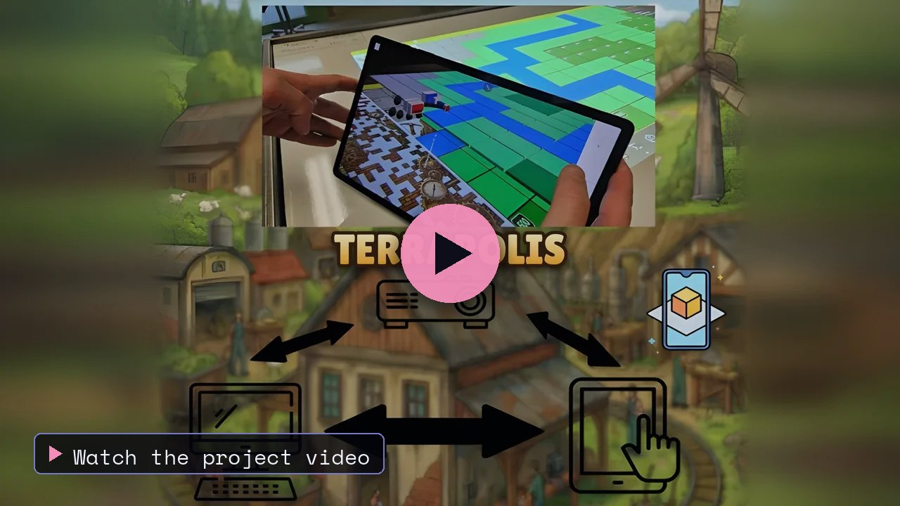
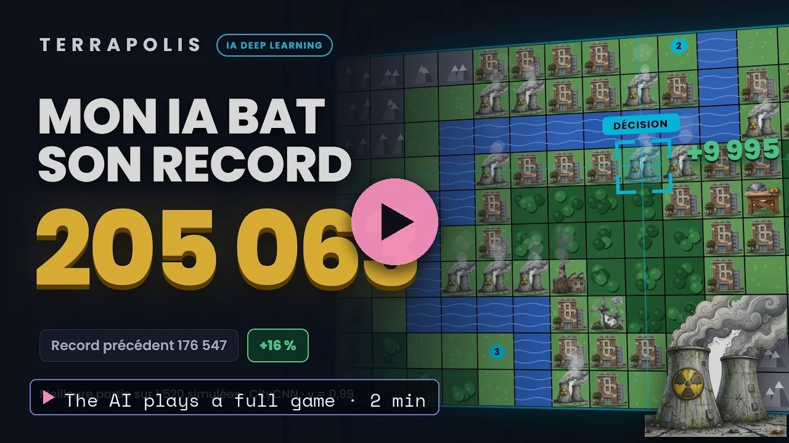
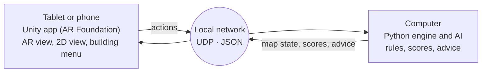
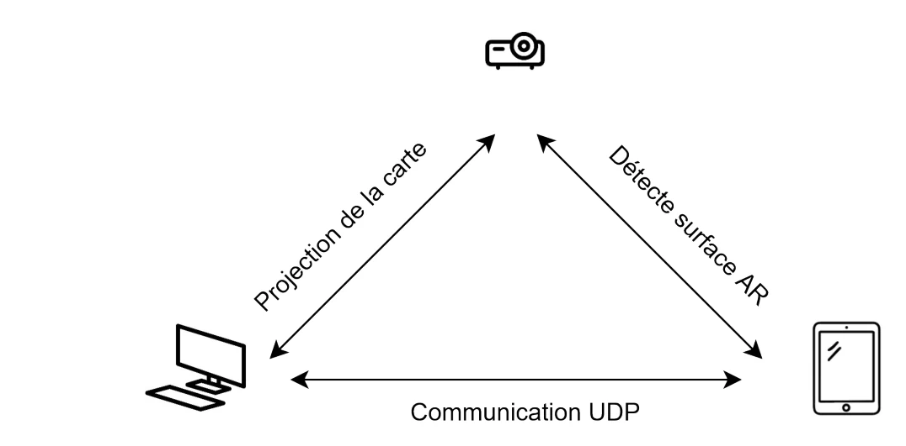
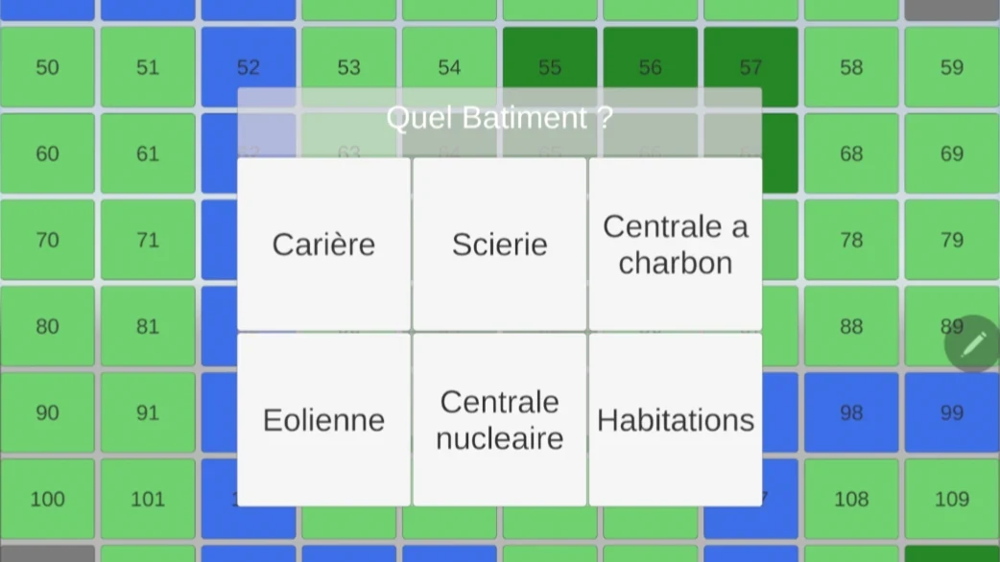
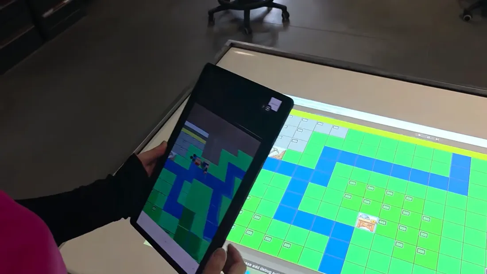
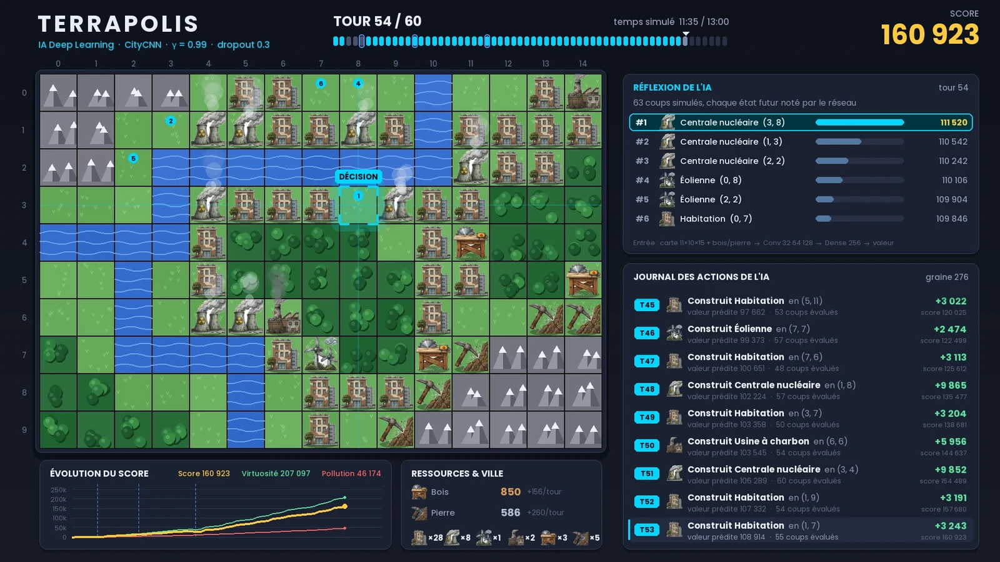
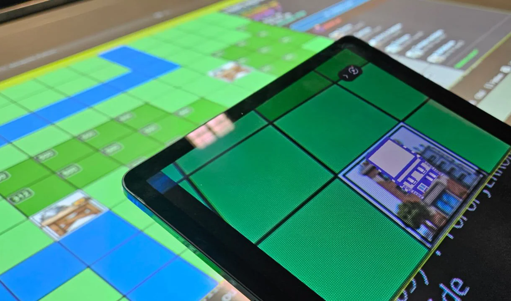
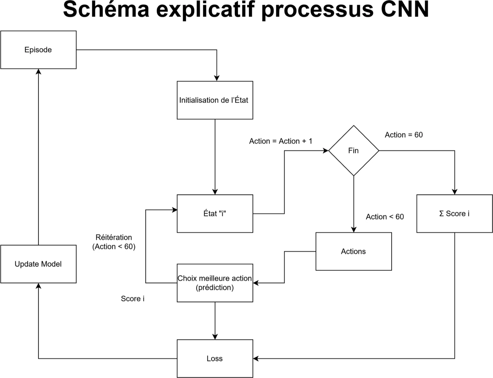
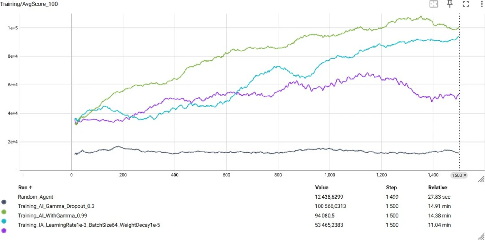

<a href="https://thibautplatet.com/en/projects/terrapolis.html"><picture><source media="(prefers-color-scheme: dark)" srcset="https://raw.githubusercontent.com/ThibPltt/ThibPltt/main/assets/repos/Terrapolis-dark.svg"><source media="(prefers-color-scheme: light)" srcset="https://raw.githubusercontent.com/ThibPltt/ThibPltt/main/assets/repos/Terrapolis-light.svg"></picture></a>

# TerraPolis

Environmental and anthropological simulation in AR, driven by Deep Reinforcement Learning (CNN).

<table>
  <tr>
    <td width="50%"><a href="https://www.youtube.com/watch?v=86Q1wE_7Ecg"></a></td>
    <td width="50%"><a href="https://www.youtube.com/watch?v=sdau2TpGC24"></a></td>
  </tr>
  <tr>
    <td><sub>The project in video.</sub></td>
    <td><sub>The AI plays its best game out of 1,520 simulated: 205,063 points.</sub></td>
  </tr>
</table>

| At a glance | |
|---|---|
| **Dates** | 2025 – 2026 |
| **Context** | augmented reality · project lead, team of 3 · ENSIM |
| **Technologies** | AR · Deep Reinforcement Learning · Unity · Python |
| **Play it** | [v1.0 Android APK](https://github.com/ThibPltt/Terrapolis/releases/latest) (AR client, ARCore device) with the Python engine on a PC, see [Run it](#run-it) |
| **Video** | [Project video](https://www.youtube.com/watch?v=86Q1wE_7Ecg) · [The AI plays a full game](https://www.youtube.com/watch?v=sdau2TpGC24) (YouTube) |
| **Case study** | [thibautplatet.com/en/projects/terrapolis.html](https://thibautplatet.com/en/projects/terrapolis.html) |
| **Code** | [`engine/`](engine) (Python engine and AI) · [`ai-training/`](ai-training) (training and evaluation) · [`ar-client/`](ar-client) (Unity AR client) |

## Problem

Show the consequences of a planning choice (pollution, floods) before anything is built: a sustainable city simulation designed for urban planning studies.

## Role

Project lead, team of 3.

## Decisions

An AI trained with Deep Reinforcement Learning (CNN), learning in stages; a Python simulation engine linked over UDP to a Unity app in augmented reality.

## Result

Working prototype, tried by visitors at the ENSIM open day. Over 1,000 games, the AI scores on average 4.75 times higher than a random strategy.

## My contribution

- Most of the artificial intelligence: problem modelling, neural network, training strategy, tuning and evaluation.
- The larger share of the state of the art: mixed reality and AI for disaster prevention.
- A part in designing the rules, in the Python simulation engine and in project management.

## Specification

| Requirement | Answer |
|---|---|
| A city to build | A fixed map of 15 × 10 tiles (mountain, forest, plain, river), two resources (wood, stone) and six buildings: sawmill, quarry, housing, coal power plant, wind turbine, nuclear power plant. |
| A score, with no win or loss | Final score = virtue of what is built − pollution (at construction, then over time) − flood damage. A game lasts 15 minutes. |
| Two hazards | Random floods (up to two per game) destroy the buildings next to rivers; industrial pollution contaminates the tiles next to sawmills, quarries and coal plants. |
| Advice on demand | An "AI advice" button suggests the best action given the resources and the free tiles: build, demolish or wait. |
| Augmented reality | The map appears on a table after scanning a QR code; buildings are placed on it in 3D, with a preview before confirming. |
| Two devices in sync | The computer computes (rules and AI in Python), the tablet displays (Unity app); they talk over UDP on the local network, in JSON. |

## How it works





<sub>The three devices: the computer projects the map, the tablet recognises it in augmented reality, and both exchange over UDP (diagram in French).</sub>

<table>
  <tr>
    <td width="33%"></td>
    <td width="33%"></td>
    <td width="33%"></td>
  </tr>
  <tr>
    <td><sub>On the tablet: the 2D view and the menu of the six buildings to place (interface in French).</sub></td>
    <td><sub>The tablet and the projected map show the same state, kept in sync over the network.</sub></td>
    <td><sub>On the computer: the map, the moves the AI evaluates at each turn and the log of its actions (interface in French).</sub></td>
  </tr>
</table>



<sub>In augmented reality, a placed building appears in 3D at its place on the map (image tracking).</sub>

## The artificial intelligence

The game grid is handled like an image: a convolutional neural network (CNN) learns, through reinforcement, which action pays off most over a whole game.

- **Inputs:** the state of the land (one matrix per type of tile and building) and the available resources. **Output:** the estimated value of each action.
- Three convolution layers (32, 64 then 128 filters, 3 × 3) that learn neighbourhoods: riverside, nearby forest, map corner…
- One game = 60 decisions, one every 15 seconds. Exploration, high at first, decreases with every episode in favour of the best moves.

**The turning point: learning in stages.** Given all the rules at once, the AI mostly learned to build nothing so as not to lose points. Training was therefore split into three phases (curriculum learning):

1. Unlimited resources, pollution ignored, a reward for building: learning the mechanics.
2. Pollution back, resources still unlimited: learning that a bad location is costly in the long run.
3. Resources reset to zero and decreasing exploration: exploiting the best behaviours.


<sub>One episode: state, choice of the best action, score, then model update (diagram in French).</sub>

## Results

| Scores | Random strategy | Trained AI |
|---|---:|---:|
| Worst score | −20,174 | −3,639 |
| Average score | 12,940 | **61,428** |
| Best score | 54,685 | **205,063** |

Worst and average scores: 1,000 test games. Best score of the AI: its best game out of 1,520 simulated. An average game by the AI (61,428) beats the best game obtained at random (54,685).


<sub>Average score (over 100 episodes) during the final training run of 1,500 episodes, tracked with TensorBoard. In green, the configuration that was kept (with a dropout of 0.3) ends around 100,600; at the bottom, the random agent stays around 12,400.</sub>

A possible improvement: starting from satellite scans of real cities or environments, to predict their future problems.

## In this repository

| Folder | Content |
|---|---|
| [`engine/`](engine) | Python engine (Pygame): game logic, UDP server for the AR app (port 5005), the CityCNN model (`terrapolis_models.py`) and its trained checkpoints (`save_terrapolis_models/`). |
| [`ai-training/`](ai-training) | AI work: `terrapolis_train.py` trains CityCNN (1,500 episodes), `terrapolis_visu.py` replays a game played by the trained model, `terrapolis_benchmark.py` and `runPurementAleatoire.py` run the random baselines; training logs and TensorBoard runs. |
| [`ar-client/`](ar-client) | Unity 2022.3.62f3 project for Android (AR Foundation): main menu, AR scene, 2D view, UDP client. |

The three folders keep the full history of the team's original repositories, [Terrapolis_Python](https://github.com/Lecureur-Arthur/Terrapolis_Python) and [Terrapolis_Unity](https://github.com/Lecureur-Arthur/Terrapolis_Unity). Each one keeps its original README, in French, renamed `Historic_README.md` ([engine](engine/Historic_README.md), [ar-client](ar-client/Historic_README.md)).

## Run it

A game needs two devices on the same Wi-Fi network: a PC running the Python engine, and an Android phone or tablet running the AR client.

Engine (Python 3.10 or later), from the `engine` folder (the `main.py` in `ai-training` is the training copy and does not answer the AR app):

```bash
cd engine
python -m venv .venv
.venv\Scripts\activate          # Windows (macOS / Linux: source .venv/bin/activate)
pip install -r requirements.txt   # numpy, torch, pygame, tqdm, tensorboard
python main.py                    # game window + UDP server on port 5005 (F11: full screen)
```

- **AR client on a phone or tablet:** download `TerraPolis-v1.0.apk` from the [latest release](https://github.com/ThibPltt/Terrapolis/releases/latest) and install it on an Android device that supports ARCore (allow installs from unknown sources). Connect it to the same Wi-Fi as the PC, not to mobile data: the app finds the PC by itself. On Windows, allow Python on private networks when the firewall asks.
- **Play:** project the engine window onto a table, scan the table with the app, then aim at the AR band on the left of the window to load the map. The AR map is drawn at projection size (about 1 m wide), so a projector works best; on a laptop screen, hold the device close to the band.
- **From the source:** open `ar-client/` with Unity **2022.3.62f3** (Android Build Support), switch the platform to Android in *File › Build Settings*, then *Build And Run* with the device connected over USB (developer mode enabled). Android settings: IL2CPP, ARM64, OpenGLES3, minimum API level 24, Google ARCore as the only XR provider. On a network that blocks broadcast, untick *Auto Detect PC* on the *AR Session* object of the `GamePlayAR` scene and enter the PC's IPv4 address in *Python IP*.

AI training and evaluation:

```bash
cd ai-training
pip install -r requirements.txt  # same list as the engine
python terrapolis_train.py       # train CityCNN
python terrapolis_visu.py        # watch the trained model play a game
python terrapolis_benchmark.py   # random strategy over 1,000 games
```

## Team

Arthur Lecureur (engine and logic, AR client), Clara Tournay (AR client), Thibaut Platet (AI and data, project lead).

## Licence

The code and the original content of this repository are released under the [MIT licence](LICENSE); each team member keeps the copyright on their own contributions.

### Third-party assets

The packages below, used by the AR client, are **not** covered by the MIT licence and stay under their publishers’ terms. To reuse them, get them from their store page.

| Folder | Asset | Source | Licence |
|---|---|---|---|
| `ar-client/Assets/Package_Assets/ElectricWire` | ElectricWire — burnydev | Unity Asset Store | [Asset Store EULA](https://unity.com/legal/as-terms) |
| `ar-client/Assets/Package_Assets/Buildings`<br>`ar-client/Assets/Package_Assets/Modern Building Set` | Low-poly building models | Unity Asset Store | Asset Store EULA |
| `ar-client/Assets/Thaleah_PixelFont` | [Free Pixel Font – Thaleah](https://assetstore.unity.com/packages/slug/140059) — Rick Hoppmann (Tiny Worlds) | Unity Asset Store / itch.io | [CC BY 4.0](https://creativecommons.org/licenses/by/4.0/) |
| `ar-client/Assets/TextMesh Pro` | TextMesh Pro — Unity | Unity package | Unity Companion Licence |

<details>
<summary>🇫🇷 En bref</summary>

Simulation environnementale et anthropologique en réalité augmentée, pilotée par Deep Reinforcement Learning (CNN) : faire comprendre les conséquences d’un choix d’aménagement (pollution, inondations) avant de construire. Moteur et IA en Python (PyTorch), client AR sous Unity. Chef de projet d’une équipe de 3 à l’ENSIM (2025 – 2026). APK Android du client AR dans les [Releases](https://github.com/ThibPltt/Terrapolis/releases/latest), à utiliser avec le moteur Python lancé sur un PC du même réseau Wi-Fi. Fiche complète sur [thibautplatet.com](https://thibautplatet.com/projets/terrapolis.html).
</details>
